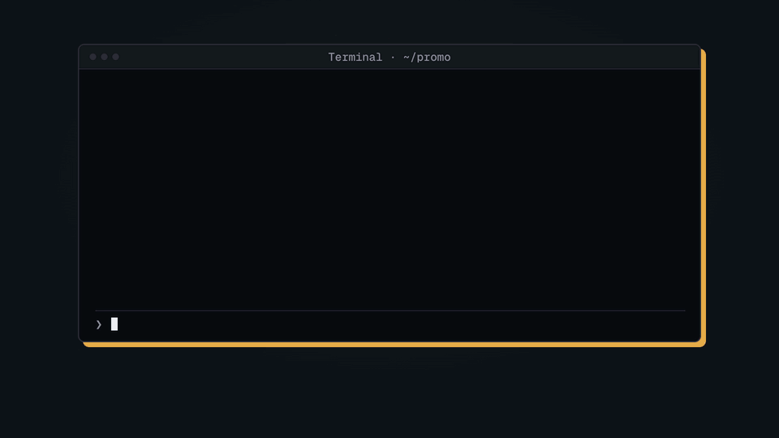

# audio-bed-check

If you render video or audio from code, this tells you when the background audio is broken before
anyone hears it.



```
npx audio-bed-check bed music.wav                         # does the bed loop? does its level jump?
npx audio-bed-check separation out/video.mp4 --vo vo.wav  # is the voice far enough above the bed?
```

Exit 0 means fine. Exit 1 means one of the three faults below, with a line saying which and where.
No dependencies. It needs Node 20.15.1 or later and ffmpeg. In a Remotion project without ffmpeg on
PATH, `--ffmpeg remotion` uses the copy Remotion installed.

## The problem

In a pipeline (Remotion, ffmpeg, a script that stitches clips), the background audio is assembled
by code rather than by someone listening. That audio is called the bed: the music under a
voiceover, the crowd, the room tone. Three things go wrong with it, and none of them fails a render
or trips a loudness meter.

- The clip was shorter than the scene, so it was looped to fill the time. The same bar comes round
  every few seconds.
- Two clips were joined and the level jumps at the seam.
- The voiceover was mixed too close to the bed. Every word is there if you listen for it, and a
  viewer will not.

## What this does

It measures the rendered file and gives a verdict a build can act on.

```
music.wav
  FAIL  loop        1.00 (repeats every 6.5s, at or above 0.90)
  FAIL  step        7.03 dB at 20.05s (max 6.00)
  info  range       12.1 dB   transient 8.9 dB   peak -2.7 dBTP
```

`bed` runs two checks on the bed alone. The loop check looks for the same material appearing twice
and reports how often it repeats. The steps check looks for a jump in level that stays, as opposed
to a swell that comes back, and reports its size and position.

`separation` takes the rendered mix and the voiceover file on its own, finds where the voice is
speaking, and measures how far above the bed it sits, in loudness units, against published floors:
10 LU over music, 15 over ambience, 20 for WCAG.

Exit 0 when every check passes, 1 when any fails, 2 when it could not run (a bad flag, an
unreadable file, a bed under 6.5 seconds, no speech found in the voiceover). A `warn` line never changes the exit code.
`--json` prints the numbers as a list of objects.

When the file list comes from a glob, put `--` before it: `npx audio-bed-check bed -- out/*`.
Without it, a file whose name starts with `-` (say `--max-step=100`) is read as an option.

On an Apple A18 Pro laptop with 8 GB of memory, `bed` on a 10-minute mono file takes about 5 s of
processor time and 0.9 GB of memory; an hour takes about 50 s and 1.8 GB.

## With Remotion

Render the music on its own and check it, then check the voice against the final mix. Here the
composition takes a `voice` prop that turns the voiceover off:

```
npx remotion render src/index.ts Promo out/bed.wav --props='{"voice":false}'
npx audio-bed-check bed out/bed.wav

npx remotion render src/index.ts Promo out/promo.mp4
npx audio-bed-check separation out/promo.mp4 --vo public/voice.wav
```

In a Remotion project with no ffmpeg of its own, add `--ffmpeg remotion` to each check.

The voiceover here starts 9 seconds in (a `<Sequence from={9 * 30}>` at 30 fps). The check finds
that from the audio and prints it as `info voice starts at 9.00s in the mix (found)`. When it can't
locate the voice, it measures from 0 and at the closest match: if both agree, that's the result,
with a warning; if they disagree, it exits 2 and asks for `--vo-offset`. `--vo-offset 9`
sets the start by hand.

## Where it finds ffmpeg

`--ffmpeg PATH`, then `$AUDIO_BED_CHECK_FFMPEG`, then `ffmpeg` on PATH. Only absolute PATH
entries are searched, so a `.` or `bin` in PATH never picks up a binary from the folder you are in.
On Windows only `.exe` files are run, never a `.cmd` or `.bat` wrapper.

`--ffmpeg remotion` (or `AUDIO_BED_CHECK_FFMPEG=remotion`) runs the ffmpeg Remotion installed in
`node_modules`, looked up from the current folder upward the way Node finds a package (macOS,
Windows x64, and Linux x64 or arm64). It is never chosen on its own, because a repository you clone
can carry a `node_modules` with any binary in it. When there is no ffmpeg on PATH and a Remotion
copy is there, the error names its path so you can decide. On macOS and Linux the binary and its
folder must also belong to you, which rules out a `node_modules` another account wrote in a shared
folder such as `/tmp`.

ffmpeg is run once per file with an argument list, never through a shell. The input is passed as
`file:PATH` with ffmpeg's protocol whitelist set to `file,pipe`, so a name like
`concat:a.wav|b.wav` is opened as a file of that name. The tool makes no network calls.

## From JavaScript

```js
import { decode, loopScore, levelSteps, separation } from "audio-bed-check";

const { samples, sr } = decode("music.wav");
loopScore(samples, sr).passed;     // false if it repeats
levelSteps(samples, sr).step_db;   // the worst sustained step, dB

const { samples: vo } = decode("vo.wav");
const { samples: mix } = decode("out/promo.mp4");
separation(vo, mix, sr, { minLu: 15 }).separation_lu;
```

`samples` is an array of one or two Float32Arrays at 48 kHz; `decode` always returns that.

## The same tool in Python

This is a port of the [Python package](https://pypi.org/project/audio-bed-check/) of the same name,
with the same checks, flags and results. Its README covers how each check works, where
the thresholds come from, and the validation of the loop check. `js/scripts/parity.py` in the
repository runs both on the same generated files and requires every number to agree.

## License

MIT.
